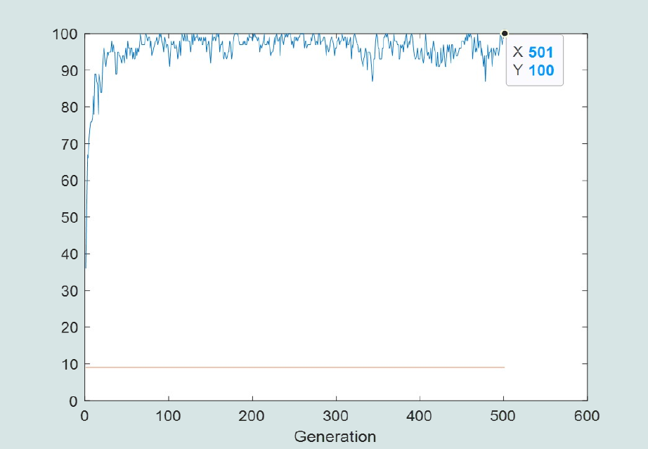
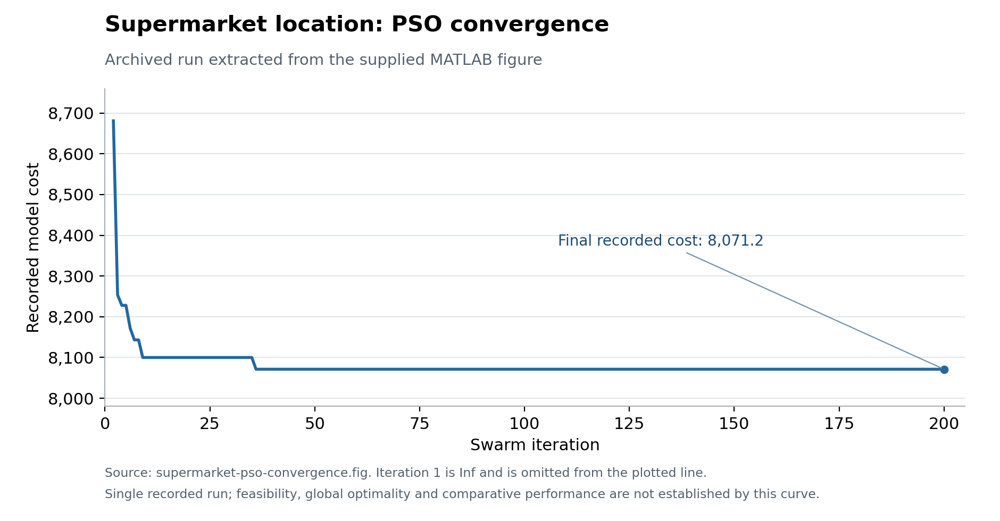

# Technical Optimization with Metaheuristics

**MATLAB · Genetic Algorithms · Simulated Annealing · Particle Swarm Optimization · Linear Programming**

Three manufacturing optimization cases: organizing assembly tasks, locating material supply points, and allocating steel-production capacity. The implementations connect problem constraints to solution encodings, search operators, and interpretable outputs.

The repository brings together custom metaheuristic implementations, alternative parameter settings, recorded convergence figures, and two equivalent linear-programming formulations. Original MATLAB files are preserved alongside portable entry scripts and focused model documentation.

| Case | Decision | Approach |
| --- | --- | --- |
| [Assembly-line balancing](docs/assembly-line.md) | Assign 35 precedence-constrained tasks to workstations under a 61-second cycle limit | Genetic algorithm with crossover and mutation variants |
| [Line-side supermarket location](docs/supermarket-location.md) | Supply 30 workstations from five candidate sites, each with capacity 60 | Simulated annealing experiments and an additional custom PSO implementation |
| [Steelmaking production planning](docs/steelmaking-lp.md) | Allocate operating hours across three machines and four girder sizes | Two equivalent continuous LP formulations |

[Setup and execution](docs/setup.md) · [Historical presentation](docs/presentation/technical-optimization-slides.pdf) · [Source manifest](data/source-manifest.json)

## Assembly-line balancing

The GA searches for task sequences that respect precedence, then assigns consecutive tasks to stations without exceeding the cycle-time limit. Its objective is to minimize the station count. The instance contains **35 tasks**, **45 precedence relationships**, and **485 seconds** of work.

The uniform-crossover baseline uses **100 candidates**, per-gene parent mixing, swap mutation, and elitism. An inversion-mutation variant and additional historical operator variants make it possible to inspect how reproduction choices affect the search.

[](docs/assets/assembly-ga-recorded-uniform.png)

*Recorded GA output: station-count convergence and the number of candidates sharing the minimum. This is a historical figure, not a new execution.*

The [assembly-line guide](docs/assembly-line.md) explains the decoder, actual operator behavior, output matrices, and workload calculation.

## Locating material supermarkets

Thirty workstations generate **186 units** of material demand. Five candidate line-side supermarkets each have capacity **60 units**. The cost combines opening supply points with demand-weighted, round-trip Manhattan shipment distance.

The SA experiments explore cooling schedules and neighborhood changes. The additional PSO implementation searches the same baseline assignment model with **100 particles and 200 iterations**. Both expose assignments, capacity loads, and cost information for inspection.

[](docs/assets/supermarket-pso-convergence.png)

*Archived PSO convergence, ending at a recorded model cost of **8,071.2**. The [extracted trace](data/recorded-pso-convergence.csv) accompanies the original [MATLAB figure](data/supermarket-pso-convergence.fig). It is not a fresh benchmark or proof of global optimality.*

See the [supermarket guide](docs/supermarket-location.md) for the cost model, variant settings, decoder restrictions, and comparison scope.

## Steelmaking production planning

The LP allocates weekly machine hours to meet demand for four girder sizes while respecting machine availability. Two MATLAB scripts express the same 12-variable model using different variable orders.

The minimum weekly operating cost is **$4,300**, independently checked with **SciPy/HiGHS** for both formulations. Feasibility, column-permutation equivalence, and a matching dual bound are checked by the included Python tool. Multiple optimal allocations exist; the saved workbook provides one historical solution.

[Model, formulations, and results](docs/steelmaking-lp.md) · [Production-plan workbook](data/steelmaking-production-plan.xlsx)

## Run a case

From the repository root in MATLAB, run one entry point:

```matlab
run_assembly_ga
run_supermarket_sa
run_supermarket_pso
run_steel_lp
```

The GA, SA, and PSO scripts use **base MATLAB**. The steelmaking scripts require **Optimization Toolbox**. Run cases separately: the preserved originals clear the calling workspace. Detailed commands and optional Python verification are in [setup](docs/setup.md).

## Project material and provenance

The [48-slide presentation](docs/presentation/technical-optimization-slides.pdf) is a historical export retaining its original credits. Its literature discussion includes [Fathi et al. (2016)](https://doi.org/10.1080/00207543.2015.1090032); no implementation of that paper's modified PSO is supplied here.

The documentation distinguishes recorded outputs from new checks. MATLAB was unavailable during repository preparation, so no new heuristic runs or algorithm rankings are claimed. The original scripts, figures, and model details remain available for reproduction and further development.
